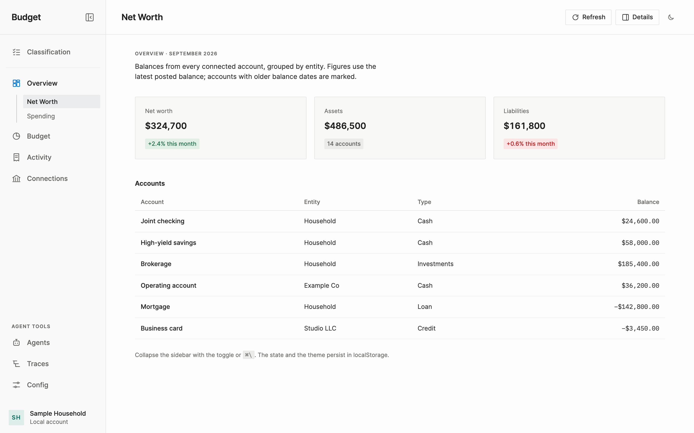
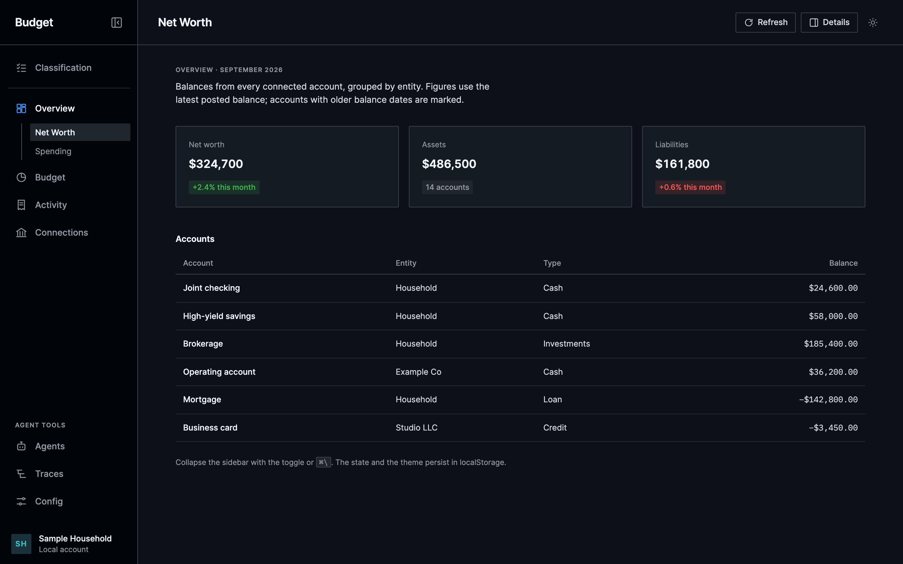
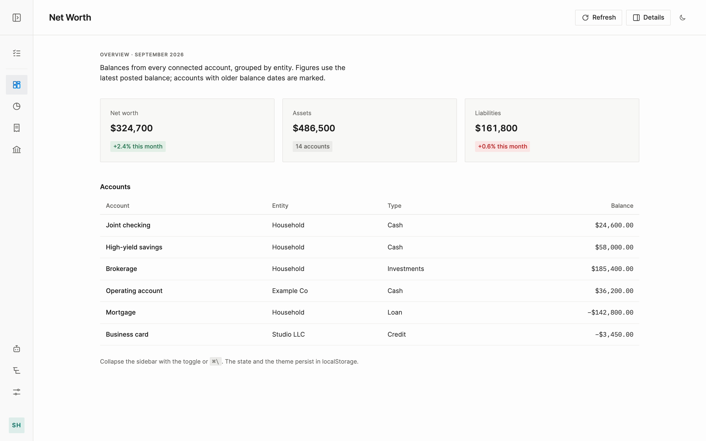
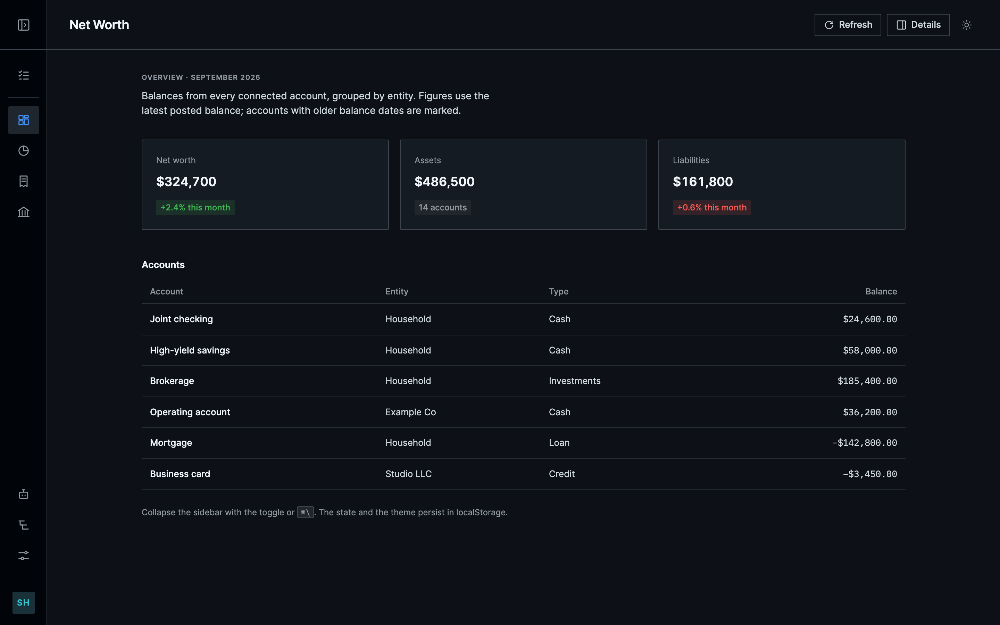
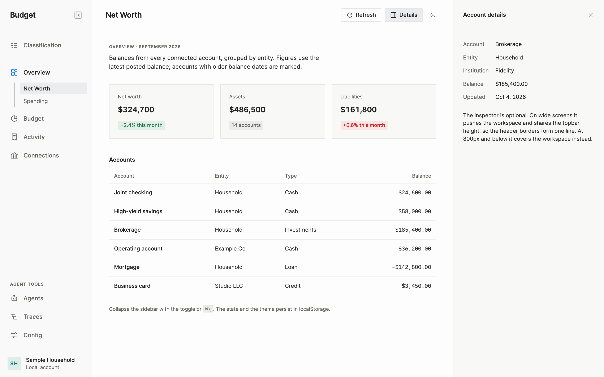
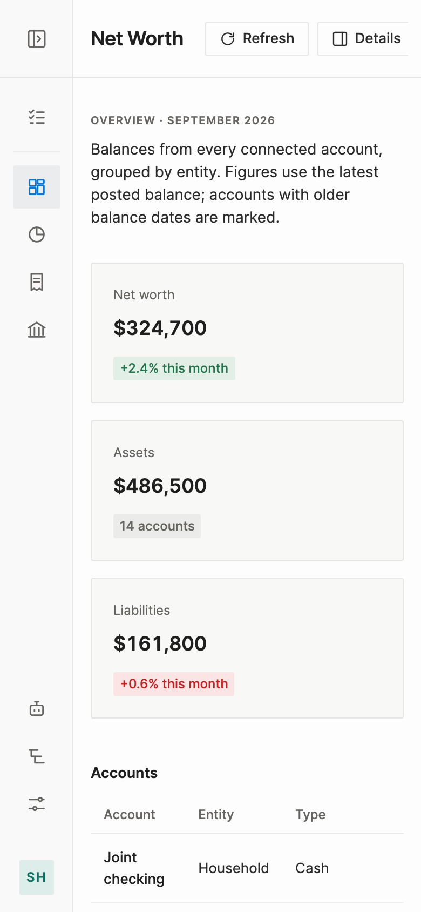

# App layout standard

Every app you click around in uses one shell: a collapsible sidebar, a sticky topbar, and the page content in a lane. An optional inspector panel docks on the right.

- CSS: [`css/layout.css`](../css/layout.css) (load after `css/fonts.css` and `dist/css/tokens.css`)
- Wiring the package into an app: [consume.md](consume.md)
- Demo: [`guide/app-shell-demo.html`](app-shell-demo.html) (open it in a browser)
- React reference: [`templates/react-app-shell/`](../templates/react-app-shell/)
- Code structure for the app around it: [code-structure.md](code-structure.md)

The shell comes from the budget app (`life/budget/apps/web/src/shared/AppLayout.tsx` and `sidebar.css`). The sizes are the budget sizes rounded to the 4px grid; the colors, type and radius are the design-system tokens.



## When it applies

| Use the shell | Do not use the shell |
| --- | --- |
| Apps with more than one view you move between: budget, ops consoles, agent and trace viewers, settings-heavy tools. | A single full-screen canvas or 3D scene (the personal-site visualizer). It keeps floating panels and uses tokens only. |
| Internal tools that grow new pages over time. | Marketing or landing pages. |
| Document workbenches (docs system) once they migrate. See [Existing shells](#existing-shells). | Embeds rendered inside another app's shell. |

If you are unsure, use the shell. One shell across apps means one set of habits: the toggle is always in the same place and `⌘\` always collapses the sidebar.

## Anatomy

```text
 .ds-sidebar (220px, 68px collapsed)   .ds-workspace                                  .ds-inspector (360px, optional)
┌──────────────────────────┬────────────────────────────────────────────────────┬──────────────────────────┐
│ Budget               [◧] │ Net Worth                     [Refresh] [Details] │ Account details        ✕ │ ← one 72px line
├──────────────────────────┼────────────────────────────────────────────────────┼──────────────────────────┤
│ ☑ Classification         │                                                    │ Account     Brokerage    │
│ ──────────────────────── │   .ds-main                                         │ Entity      Household    │
│ ▦ Overview               │   content capped at a lane (wide: 1100px),         │ Balance     $185,400.00  │
│ │  Net Worth  ◀ current  │   centred, 40px side padding                       │                          │
│ │  Spending              │                                                    │ .ds-inspector-body       │
│ ◔ Budget                 │                                                    │                          │
│ ▤ Activity               │                                                    │                          │
│ ⌂ Connections            │                                                    │                          │
│                          │                                                    │                          │
│ AGENT TOOLS              │  ← .ds-nav[data-placement="end"] sits at the       │                          │
│ ☺ Agents                 │    bottom of the sidebar                           │                          │
│ ≡ Traces                 │                                                    │                          │
│ ⚙ Config                 │                                                    │                          │
│ [SH] Sample Household    │  ← .ds-sidebar-footer slot                         │                          │
└──────────────────────────┴────────────────────────────────────────────────────┴──────────────────────────┘
```

Collapsed, the sidebar becomes a 68px icon rail. The icons stay in place; labels, the title, subnavs and the nav heading go away.

```text
┌──────┬──────────────────────────────────────────────┐
│  [◨] │ Net Worth               [Refresh] [Details]  │
├──────┼──────────────────────────────────────────────┤
│  ☑   │                                              │
│ ──── │                                              │
│ [▦]  │  ← the section that holds the current page   │
│  ◔   │    gets the fill while its subnav is hidden  │
│  ▤   │                                              │
│  ⌂   │                                              │
│      │                                              │
│  ☺   │                                              │
│  ≡   │                                              │
│  ⚙   │                                              │
│ [SH] │                                              │
└──────┴──────────────────────────────────────────────┘
```

### Markup

```html
<div class="ds-shell" data-sidebar="expanded" data-inspector="closed">
  <a class="ds-skip-link" href="#main">Skip to content</a>

  <aside class="ds-sidebar" id="app-sidebar" aria-label="Sidebar">
    <div class="ds-sidebar-header">
      <span class="ds-sidebar-title">Budget</span>
      <button class="ds-shell-icon-button ds-sidebar-toggle" type="button"
              aria-label="Toggle sidebar" aria-expanded="true" aria-controls="app-sidebar"
              aria-keyshortcuts="Meta+\ Control+\" title="Collapse sidebar (⌘\)">
        <svg viewBox="0 0 24 24" aria-hidden="true" …>
          <rect x="3" y="3" width="18" height="18" rx="2" /><path d="M9 3v18" />
          <path class="ds-sidebar-toggle-arrow" d="m16 9-3 3 3 3" />
        </svg>
      </button>
    </div>

    <div class="ds-sidebar-body">
      <nav class="ds-nav" aria-label="Primary">
        <a class="ds-nav-item" href="/review">
          <span class="ds-nav-icon" aria-hidden="true"><svg …/></span>
          <span class="ds-nav-label">Classification</span>
        </a>
        <hr class="ds-sidebar-divider" />
        <a class="ds-nav-item" href="/overview" data-active="true">…Overview…</a>
        <div class="ds-subnav" role="group" aria-label="Overview">
          <a class="ds-subnav-item" href="/net-worth" aria-current="page">Net Worth</a>
          <a class="ds-subnav-item" href="/spending">Spending</a>
        </div>
      </nav>
      <nav class="ds-nav" data-placement="end" aria-labelledby="tools-heading">
        <p class="ds-nav-heading" id="tools-heading">Agent tools</p>
        <a class="ds-nav-item" href="/config">…Config…</a>
      </nav>
    </div>

    <div class="ds-sidebar-footer">
      <span class="ds-avatar" aria-hidden="true">SH</span>
      <span class="ds-sidebar-footer-text">
        <span class="ds-sidebar-footer-name">Sample Household</span>
        <span class="ds-sidebar-footer-meta">Local account</span>
      </span>
    </div>
  </aside>

  <div class="ds-workspace">
    <header class="ds-topbar">
      <h1 class="ds-topbar-title">Net Worth</h1>
      <div class="ds-topbar-actions">
        <button class="ds-shell-button" type="button">Refresh</button>
      </div>
    </header>
    <main class="ds-main" id="main" tabindex="-1">…</main>
  </div>

  <aside class="ds-inspector" id="inspector" aria-label="Account details">
    <div class="ds-inspector-header">
      <h2 class="ds-inspector-title">Account details</h2>
      <button class="ds-shell-icon-button" type="button" aria-label="Close account details">…</button>
    </div>
    <div class="ds-inspector-body">…</div>
  </aside>
</div>
```

### Classes

| Class | Part |
| --- | --- |
| `.ds-shell` | Grid root. Holds `data-sidebar` and `data-inspector`. Sets the base font (`--ds-font-size-ui-lg`), color and page background. |
| `.ds-skip-link` | First focusable element. Hidden until focused. |
| `.ds-sidebar` | Sticky, full-height column. Clips its content while it collapses. Its edge is an inset line, so it takes no width. |
| `.ds-sidebar-header`, `.ds-sidebar-title` | App name and the collapse toggle, one topbar-height row. |
| `.ds-sidebar-toggle` | The collapse button. Combine with `.ds-shell-icon-button`. |
| `.ds-sidebar-toggle-arrow` | The chevron path inside the toggle glyph. Flips when collapsed. |
| `.ds-sidebar-body` | Scroll region between header and footer. |
| `.ds-nav`, `.ds-nav[data-placement="end"]` | A group of nav items. `end` pushes the group to the bottom. |
| `.ds-nav-heading` | Optional visible group label. Hidden in the rail. |
| `.ds-nav-item`, `.ds-nav-icon`, `.ds-nav-label` | A top-level row: icon plus label. Works on `<a>` and `<button>`. |
| `.ds-subnav`, `.ds-subnav-item` | Rows under the active section, with a guide line. Works on `<a>` and `<button>`. Nest a `.ds-subnav` for a third level. |
| `.ds-sidebar-divider` | `<hr>` between nav rows. |
| `.ds-sidebar-footer`, `.ds-avatar`, `.ds-sidebar-footer-text`, `-name`, `-meta` | Footer slot, usually the account card. |
| `.ds-workspace` | Topbar plus main. |
| `.ds-topbar`, `.ds-topbar-title`, `.ds-topbar-actions` | Sticky page header: `h1` and actions. |
| `.ds-main` | Page content. `data-lane` picks the lane. |
| `.ds-inspector`, `-header`, `-title`, `-body` | Optional right panel. |
| `.ds-shell-button`, `.ds-shell-icon-button` | Quiet buttons for shell chrome (topbar actions, toggle, close). |

## Tokens

Layout tokens live in [`tokens/base/app-shell.tokens.json`](../tokens/base/app-shell.tokens.json).

| Token | Value | Budget app source |
| --- | --- | --- |
| `--ds-layout-sidebar-width` | 220px | `aside` width 218px |
| `--ds-layout-sidebar-width-collapsed` | 68px | `.sidebar-collapsed .main-sidebar` 68px |
| `--ds-layout-sidebar-padding-x` | 12px | `--sidebar-padding` 12px |
| `--ds-layout-sidebar-item-height` | 40px | nav row: 11px + 22px icon + 11px |
| `--ds-layout-sidebar-item-padding-x` | 12px | `nav a` padding-inline 12px |
| `--ds-layout-sidebar-icon-size` | 20px | `.outline-icon` 20px (22px in the nav) |
| `--ds-layout-sidebar-subitem-height` | 28px | subnav row: 7px + 12px line + 7px |
| `--ds-layout-sidebar-toggle-size` | 32px | `.sidebar-toggle` 32px |
| `--ds-layout-sidebar-avatar-size` | 32px | `.avatar` 31px |
| `--ds-layout-topbar-height` | 72px | `.workspace-topbar` and `.sidebar-header` 72px |
| `--ds-layout-topbar-padding-x` | 32px | `.workspace-topbar` padding 0 32px |
| `--ds-layout-inspector-width` | 360px | `SidePeek` width `min(360px, 40vw)` |
| `--ds-layout-content-padding-x` | 40px | `main` padding-inline 42px |
| `--ds-layout-content-padding-top` | 32px | `main` padding-top 34px |
| `--ds-layout-content-padding-bottom` | 48px | `main` padding-bottom 48px |

One rule ties the sidebar numbers together: `width-collapsed = 2 × (padding-x + item-padding-x) + icon-size` (68 = 2 × 24 + 20). Each icon starts 24px from the sidebar edge in both states, which centres it in the 68px rail, so nothing jumps when the sidebar collapses. The toggle and the footer avatar share one centre line, 2px before the icon centres, because centring them exactly needs an off-grid 18px padding (`(68 - 32) / 2`). If you change one of these tokens, keep the rule true.

The shell also reads these shared tokens:

| Role | Tokens |
| --- | --- |
| Surfaces | `--ds-color-surface-page` (page, topbar), `--ds-color-surface-sidebar`, `--ds-color-surface-panel` (inspector) |
| Text | `--ds-color-text-ink` (titles, hover, current), `--ds-color-text-body`, `--ds-color-text-muted` (nav rows, headings), `--ds-color-text-faint` (disabled) |
| Lines | `--ds-color-border-default` (frame edges), `--ds-color-border-subtle` (dividers), `--ds-color-border-guide` (subnav guide line) |
| Fills | `--ds-color-fill-hover`, `--ds-color-fill-active` (current row), `--ds-color-accent` (current icon), `--ds-color-focus-ring` |
| Type | `--ds-font-family-sans`, `--ds-font-size-ui-lg` (base and nav rows), `-ui-md`, `-ui-sm`, `-ui-xs`, `-micro`, `-reading` (titles), weights, `--ds-line-height-ui`, `-tight`, `--ds-letter-spacing-title`, `-micro` |
| Avatar | `--ds-color-teal-soft`, `--ds-color-teal-text` |
| Shape and motion | `--ds-radius-base`, `--ds-border-width-hairline`, `-focus`, `--ds-focus-ring-offset`, `--ds-motion-duration-fast`, `-slow`, `--ds-motion-easing-standard`, `--ds-z-raised` |
| Lanes | `--ds-layout-lane-text`, `-code`, `-wide` |

To change a size for one app, override the token on the shell, never with a literal in a component:

```css
/* A docs tree needs a wider sidebar. */
.docs-app.ds-shell { --ds-layout-sidebar-width: 288px; }
```

## Behavior rules

1. **Toggle placement and icon.** The toggle is the last item in the sidebar header, at its right end. The glyph is a panel outline with a divider and a chevron. The chevron points left (collapse) when expanded and right (expand) when collapsed. Never put the toggle in the topbar, and never hide the sidebar completely: the rail stays.
2. **Collapsed icon rail.** `data-sidebar="collapsed"` on `.ds-shell` narrows the grid column to `--ds-layout-sidebar-width-collapsed`. Labels, the title and the footer text fade out and clip under the rail edge. Subnavs and nav headings are removed. The row of the section that holds the current page takes the fill, because its subnav is hidden. The toggle ends up in the rail, on the footer avatar's centre line.
3. **Tooltips.** In the rail every nav row carries `title="<label>"`. Remove the `title` when expanded; the label is visible. The label stays in the DOM in both states, so the link keeps its accessible name.
4. **Persistence.** Store the state in `localStorage` under `<app>.sidebar` with the values `collapsed` or `expanded`. Read it before the first paint (inline script or a lazy `useState` initializer), so no width transition plays on load. With no stored value, start collapsed when the viewport is 800px wide or less.
5. **Shortcut.** `⌘\` on macOS, `Ctrl+\` elsewhere, from anywhere in the app, including text fields. Match `event.key === "\\"` or `event.code === "Backslash"`, require Meta or Control, ignore the event when Alt or Shift is held, and call `preventDefault()`. Show the shortcut in the toggle's `title` and declare it with `aria-keyshortcuts="Meta+\ Control+\"` (key values, not key codes).
6. **Subnav.** A section's subnav shows under it while the section holds the current page. It is inline, never a flyout. Its text lines up with the parent label, and a guide line runs under the parent icon. A third level nests one more `.ds-subnav` (one 12px indent, no second guide line). Keep it to three levels.
7. **Current page.** The current page's row gets `aria-current="page"`. The section row above it gets `data-active="true"`, not `aria-current`. Only one row is filled in the expanded sidebar.
8. **Reduced motion.** The grid column animates over `--ds-motion-duration-slow`; labels fade over `--ds-motion-duration-fast`. Under `prefers-reduced-motion: reduce` every shell transition is off.
9. **Accessibility attributes.**
   - Toggle: `aria-label="Toggle sidebar"`, `aria-expanded` (true when expanded), `aria-controls` (sidebar id), `aria-keyshortcuts`.
   - Sidebar: `<aside aria-label="Sidebar">`; each group is a `<nav>` with `aria-label`, or `aria-labelledby` pointing at its `.ds-nav-heading`.
   - Subnav: `role="group"` with `aria-label` set to the section name.
   - Inspector opener: `aria-expanded` and `aria-controls`. The inspector is an `<aside>` with `aria-label`; `Escape` closes it; focus moves into it on open and back to the opener on close.
   - Main: `id` for the skip link and `tabindex="-1"` so the skip link can focus it.
   - Focus: every interactive part shows a `--ds-border-width-focus` ring in `--ds-color-focus-ring` with `--ds-focus-ring-offset`. Under `forced-colors: active` the current row and pressed shell buttons get an outline, because fills disappear.
10. **Topbar.** One `h1` per page: the page title, the same words as the document title. Actions sit on the right; keep three or fewer visible and move the rest into a menu. The topbar is sticky and has the same height as the sidebar header, so their bottom borders form one line. The title takes its natural width up to half the bar and never shrinks below that. When the bar runs out of room, the actions scroll sideways.
11. **Inspector.** Optional. It pushes the workspace instead of covering it, uses `--ds-layout-inspector-width`, and keeps the topbar height for its header. Keep it mounted while closed so it can slide out; `data-inspector` on the shell opens and closes it.
12. **Scrolling.** The document scrolls. The sidebar and inspector are sticky and scroll on their own. Do not add a scroll container inside `.ds-main` unless the page is a tool view on the `full` lane. The page never scrolls sideways: put wide content, such as a table, in its own box with `overflow-x: auto`.
13. **Narrow screens (800px and below).** The sidebar starts collapsed when no choice is stored. Content and topbar padding drop to `--ds-space-4`. The inspector covers the workspace from the end edge instead of pushing it, at `--ds-layout-inspector-width` or the full width, whichever is smaller. CSS and script use the same 800px.

## Content lanes

`.ds-main` centres the content and caps the content box at a lane. Padding sits outside the lane.

| `data-lane` | Max content width | Use for |
| --- | --- | --- |
| (none) or `wide` | `--ds-layout-lane-wide` (1100px) | Default. Dashboards, tables, forms, lists. |
| `text` | `--ds-layout-lane-text` (60ch) | Prose pages: help, release notes, long descriptions. |
| `code` | `--ds-layout-lane-code` (88ch) | Code, logs, diffs, pseudocode. |
| `full` | none | Tool views that need the whole width: trace timelines, agent viewers, editors. |

`ch` resolves at the font size of `.ds-main` (`--ds-font-size-ui-lg` by default). Put a larger reading size on an inner `<article>` if the page is long-form reading.

Content padding: `--ds-layout-content-padding-top` (32px) under the topbar, `--ds-layout-content-padding-x` (40px on the sides, 16px at 800px and below), `--ds-layout-content-padding-bottom` (48px) at the end.

## Density

| Part | Size | Text |
| --- | --- | --- |
| Topbar and sidebar header | 72px | Title: `--ds-font-size-reading` (18px), semibold, `--ds-letter-spacing-title` |
| Nav row | 40px, 4px apart, 20px icon, 12px icon-to-label gap | `--ds-font-size-ui-lg` (14px), medium |
| Subnav row | 28px, 2px apart | `--ds-font-size-ui-sm` (13px), regular (medium when current) |
| Nav heading | about 20px | `--ds-font-size-micro`, semibold, uppercase, `--ds-letter-spacing-micro` |
| Footer | 32px avatar, 16px block padding | name `--ds-font-size-ui-sm`, meta `--ds-font-size-ui-xs` |
| Shell buttons | 32px tall | `--ds-font-size-ui-sm`, medium |

These are the budget app's proportions. Page content inside `.ds-main` can be denser (tables at `--ds-font-size-ui-sm`); the shell stays at this density so every app feels the same.

## Do and don't

| Do | Don't |
| --- | --- |
| Give every top-level nav row an icon. The rail shows only icons. | Add a top-level row without an icon. |
| Keep labels short (18 characters or fewer) and keep the primary nav to about 7 rows. | Let labels wrap or truncate in the expanded sidebar. |
| Put tools, settings and admin pages in the `end` nav. | Mix tools into the primary nav. |
| Use `data-active` on the section row and `aria-current="page"` on the page row. | Put `aria-current` on two rows. |
| Override layout tokens on `.ds-shell` when an app needs a different size. | Restyle shell classes with literal colors or sizes. |
| Put page actions in `.ds-topbar-actions`. | Put page actions in the sidebar. |
| Use the inspector for details of a selected row. | Open the inspector as a modal or an overlay. |
| Keep the shell the same in every app. | Build a per-app sidebar. |

## Existing shells

These shells keep working as they are. They migrate to this standard later, one app at a time.

| App | Shell today | Migration |
| --- | --- | --- |
| Budget (`life/budget/apps/web`) | The source of this layout. `shared/AppLayout.tsx` toggles `.sidebar-collapsed` on `.app`; `aside` is `position: fixed` and `.workspace` uses `margin-left`. Six copies of the subnav rule (`.overview-subnav`, `.budget-subnav`, …). State is not persisted and there is no shortcut. Colors are literals. `SidePeek` is a fixed overlay with `margin-right` on the workspace. | Swap the classes for `ds-` classes, use one `.ds-subnav`, replace the `collapsed` state with `useSidebarCollapsed` from the template (adds persistence and `⌘\`), and turn `SidePeek` into the inspector column. |
| Docs system (`codecaine/core/docs-system`, `docs-workbench/web/src/shell/App.tsx`) | 288px tree sidebar (`w-72`) with a 44px header and no collapse. A side-peek push drawer and a collapsible style rail (persisted as `docs-style-rail-collapsed`) on the right. `--docs-*` variables. | Adopt `.ds-shell` with `--ds-layout-sidebar-width: 288px` for the tree, map the style rail to the inspector column, and move the header to the topbar height. |
| Ops console (`hey-bubba/.../ops-console/frontend`, Next.js) | Tailwind sidebar in `app/layout.tsx` with grouped `NavLink`s and an active bar. No collapse. | Copy the template's `AppShell` and render it through a client `app/_components/RouterShell/` from `app/layout.tsx` (template README); `NavLink` becomes `NavItem`. |
| Personal site (`lascari-ai/personal-site`) | Full-screen 3D canvas with floating glass panels on both sides. | Exempt from the shell. Adopt tokens only. |

## Checklist for a new app

1. Load `@codecaine-ai/design-system/fonts.css` (Inter and IBM Plex Mono), then `@codecaine-ai/design-system/tokens.css` (`tokens-dark-first.css` on a dark-first surface), then `@codecaine-ai/design-system/layout.css`, once at the app root. [consume.md](consume.md) shows how to depend on the package.
2. Copy `templates/react-app-shell/src/_components/AppShell/` (React) or the markup above (anything else).
3. Write the nav config. Every top-level row has an icon; tools go in an `end` section.
4. Pick a storage key: `<app>.sidebar`.
5. Set `data-theme` on `<html>`. `tokens.css` sets `color-scheme` with it, so scrollbars and form controls follow the theme.
6. Check by hand: toggle, `⌘\`, reload keeps the state, dark theme, keyboard only, reduced motion, and a 390px-wide window (no sideways scroll).

## Known gaps

- **No breakpoint token.** CSS custom properties cannot be used in media queries, so 800px is written twice: the `@media (max-width: 800px)` block in `css/layout.css` and `NARROW_VIEWPORT_QUERY` in the template. Change both together. A build-time `@custom-media` plus an exported constant would make it one value.
- **No UI heading size.** The topbar and sidebar titles use `--ds-font-size-reading` (18px), the closest token. A `--ds-font-size-heading` would say what it means.
- **Rail tooltips are native `title` tooltips.** They do not show on keyboard focus. A styled tooltip waits for a popover or anchor-positioning primitive.

## Screenshots

| | Light | Dark |
| --- | --- | --- |
| Expanded |  |  |
| Collapsed |  |  |

Inspector open, light:



390px wide, light: the rail, 16px padding, stacked cards, scrolling topbar actions.



The demo takes `?sidebar=collapsed|expanded`, `?theme=light|dark` and `?inspector=open` for repeatable screenshots; these do not persist.
